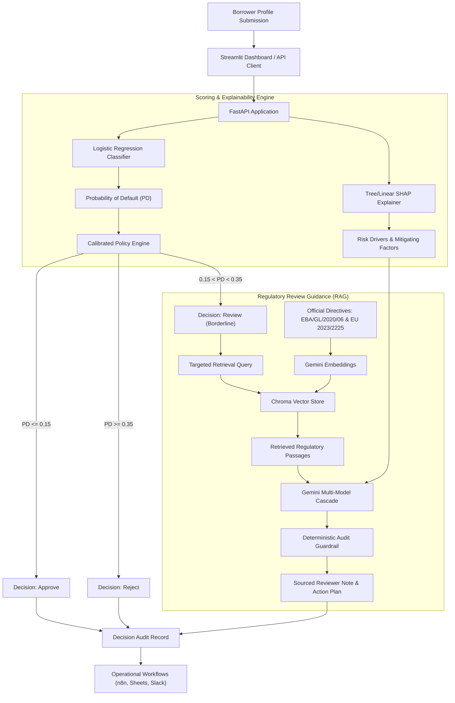
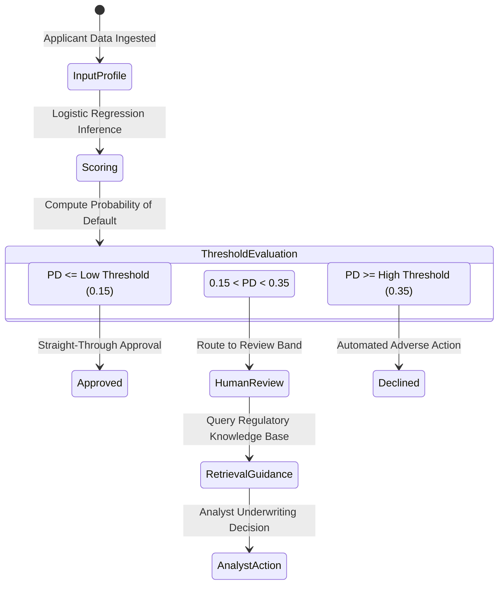
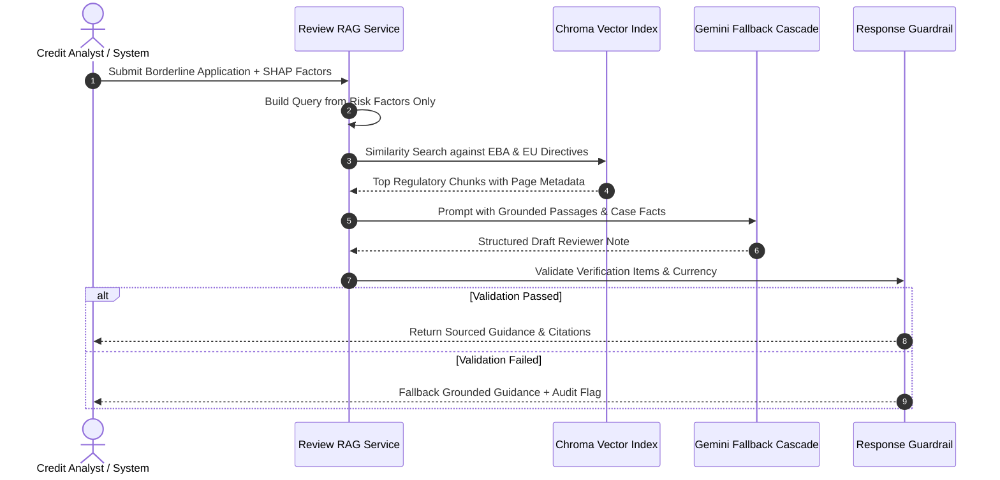

# Credit Risk Decision & Review System

> **Live Application:** [credit-risk-decisions.streamlit.app](https://credit-risk-decisions.streamlit.app/)

[](https://credit-risk-decisions.streamlit.app/)
[](https://www.python.org/)
[](https://fastapi.tiangolo.com/)
[](https://scikit-learn.org/)
[](https://ai.google.dev/)
[](https://www.langchain.com/)

An explainable credit risk underwriting engine combining calibrated logistic regression scoring, SHAP local interpretability, automated decision policies, and regulatory retrieval-augmented guidance for borderline loan applications.

---

## System Architecture



---

## What It Does

This platform replaces black-box credit scoring with a transparent, audited, and policy-governed underwriting workflow:

- **Calibrated Default Scoring**: Computes a continuous Probability of Default (PD) from raw borrower attributes using an interpretable Logistic Regression model trained on historical credit performance.
- **Three-Tier Policy Routing**: Translates continuous risk into deterministic operational actions:
  - **Approve** (PD <= 0.15): Automated straight-through approval for low-risk applicants.
  - **Review** (0.15 < PD < 0.35): Escapes borderline profiles into a governed human-in-the-loop review band.
  - **Reject** (PD >= 0.35): Automated decline for applicants exceeding risk tolerance thresholds.
- **Local Attribution via SHAP**: Decomposes the mathematical model output into exact feature-level credit drivers, isolating the primary risk-increasing attributes (e.g., loan duration, credit history) and mitigating attributes (e.g., existing savings, employment stability).
- **Domain-Grounded Regulatory Guidance (RAG)**: For applications in the review band, queries an indexed vector database of official European Banking Authority guidelines and EU Directives to draft a standardized review checklist for credit analysts.
- **Hallucination Guardrails**: Programmatically inspects generated reviewer guidance to verify that requested evidence exclusively targets documented risk-increasing factors, enforces correct currency standards, and normalizes output text for audit compliance.
- **Workflow Automation**: Dispatches structured decision payloads to n8n webhooks for real-time audit logging to Google Sheets and stakeholder alerting across Slack and Gmail.

---

## Decision Policy & Calibration

The system evaluates applicants against dual operating constraints to balance loan volume against credit losses.



### Policy Threshold Reference

| Decision Tier | Probability of Default (PD) | Operational Action | Guidance Generated |
| :--- | :--- | :--- | :--- |
| **Approve** | `PD <= 0.15` | Automated execution | None required |
| **Review** | `0.15 < PD < 0.35` | Manual underwriter inspection | Official regulatory checklist |
| **Reject** | `PD >= 0.35` | Automated adverse action notice | SHAP adverse factors |

---

## Review-Only RAG Architecture

For borderline credit applications, the system activates a specialized retrieval-augmented generation layer. This component never assigns risk scores or replaces the quantitative model; it exclusively provides regulatory context to human analysts.



### Official Regulatory Knowledge Base

The retrieval index is built directly from primary official legal publications stored in `knowledge_base/pdfs/`:

1. **European Banking Authority (EBA)**: *Guidelines on loan origination and monitoring* (`EBA/GL/2020/06`, 29 May 2020).
2. **European Parliament & Council**: *Directive (EU) 2023/2225 on credit agreements for consumers* (30 October 2023).

Passages are embedded using `gemini-embedding-001` and stored in a persistent Chroma vector index (`vector_store/official_pdf_review_chroma/`).

---

## Tech Stack

- **Application & Serving**: FastAPI, Uvicorn, Streamlit, Pydantic
- **Machine Learning**: Scikit-Learn (Logistic Regression, One-Hot Encoding), Joblib
- **Model Explainability**: SHAP (LinearExplainer / KernelExplainer)
- **Generative AI & LLM**: Google GenAI SDK (`google-genai`), Cascade: `gemini-3.8-flash` -> `gemini-3.5-flash-lite` -> `gemini-2.5-flash`
- **Embeddings & Vector Store**: `gemini-embedding-001`, LangChain, ChromaDB, PyPDF
- **Orchestration & Workflow**: n8n, Google Sheets API, Slack Webhooks, Gmail API
- **Testing & Verification**: Python `unittest`, Streamlit AppTest framework

---

## API Reference & Usage

### 1. Scoring Endpoint: `POST /predict`

Scores an applicant profile, computes SHAP values, and determines the business decision.

#### Request Example

```bash
curl -X POST "http://localhost:8000/predict"      -H "Content-Type: application/json"      -d '{
       "status": "no checking account",
       "duration": 42,
       "credit_history": "all credits at this bank paid back duly",
       "purpose": "radio/television",
       "amount": 7882,
       "savings": "100 <= ... < 500 DM",
       "employment_duration": "4 <= ... < 7 yrs",
       "installment_rate": 2,
       "personal_status_sex": "male : single",
       "other_debtors": "guarantor",
       "present_residence": 4,
       "property": "building society savings agreement/life insurance",
       "age": 45,
       "other_installment_plans": "none",
       "housing": "for free",
       "number_credits": 1,
       "job": "skilled employee / official",
       "people_liable": 2,
       "telephone": "none",
       "foreign_worker": "yes"
     }'
```

#### Response Example

```json
{
  "pd": 0.2832,
  "decision": "Review",
  "review_required": true,
  "decision_reason": "longer loan duration pushes the assessment toward higher risk",
  "applicant_expected_loss": 2232.05,
  "policy_version": "0.15-0.35",
  "policy_low_threshold": 0.15,
  "policy_high_threshold": 0.35,
  "policy_constraints_met": false,
  "policy_selection_reason": "Selected candidate min_loss_candidate as the lowest-loss fallback policy."
}
```

---

### 2. Review Guidance Endpoint: `POST /review-summary`

Executes the RAG pipeline to generate grounded regulatory guidance for review cases.

#### Request Example

```bash
curl -X POST "http://localhost:8000/review-summary"      -H "Content-Type: application/json"      -d '{
       "applicant": {
         "status": "no checking account",
         "duration": 42,
         "credit_history": "all credits at this bank paid back duly",
         "purpose": "radio/television",
         "amount": 7882,
         "savings": "100 <= ... < 500 DM",
         "employment_duration": "4 <= ... < 7 yrs",
         "installment_rate": 2,
         "personal_status_sex": "male : single",
         "other_debtors": "guarantor",
         "present_residence": 4,
         "property": "building society savings agreement/life insurance",
         "age": 45,
         "other_installment_plans": "none",
         "housing": "for free",
         "number_credits": 1,
         "job": "skilled employee / official",
         "people_liable": 2,
         "telephone": "none",
         "foreign_worker": "yes"
       },
       "prediction": {
         "pd": 0.2832,
         "decision": "Review",
         "review_required": true,
         "decision_reason": "longer loan duration pushes the assessment toward higher risk"
       }
     }'
```

#### Response Example

```json
{
  "review_summary": "1. Why this case needs review\nThe application exhibits a probability of default of 0.283 under standard risk policies. The primary risk-increasing factor identified by feature attribution is extended loan duration (42 months).\n\n2. Evidence to verify\nVerify applicant income stability and cash flow sustainability across the requested 42-month amortization horizon [Source 1, Source 3].\n\n3. Suggested analyst action\nPerform a structured creditworthiness assessment verifying repayment capacity without relying on asset liquidation [Source 2].",
  "knowledge_base_sources": [
    {
      "authority": "European Banking Authority",
      "title": "Guidelines on loan origination and monitoring",
      "page": 44,
      "url": "https://www.eba.europa.eu/sites/default/documents/files/document_library/Publications/Guidelines/2020/Guidelines%20on%20loan%20origination%20and%20monitoring/884248/EBA%20GL%202020%2006%20Final%20Report%20on%20GL%20on%20loan%20origination%20and%20monitoring.pdf"
    }
  ],
  "llm_model": "gemini-3.5-flash-lite",
  "embedding_model": "gemini-embedding-001",
  "retrieval_policy_version": "v1.2",
  "review_guardrail_applied": false
}
```

---

## Interactive Streamlit Dashboard

The user interface provides underwriting teams with an interactive portal:

- **Preset Benchmark Profiles**: Instantly load canonical applicant profiles (`Approved Borrower`, `Borderline Review Case`, `Declined High-Risk Profile`).
- **Interactive Underwriting Sliders**: Modify loan terms, checking status, credit amounts, and employment length with real-time recalculation.
- **Visual Risk Gauge & Delta Metrics**: Observe continuous PD against color-coded policy bands.
- **SHAP Feature Impact Charts**: Inspect horizontal bar charts detailing exact directional contributions per applicant attribute.
- **Regulatory Checklist & Source Links**: Review cited PDF excerpts alongside direct links to the official European Banking Authority and European Union documentation.
- **Zero-Config Cloud Fallback**: Automatically connects to a local FastAPI backend or executes via an internal in-process engine when deployed on Streamlit Community Cloud.

---

## Local Setup & Quickstart

### Prerequisites

- Python 3.10 or higher
- Google Gemini API key

### 1. Clone & Install Dependencies

```bash
git clone https://github.com/vm7151810/Credit-Risk-Decision.git
cd Credit-Risk-Decision

python -m venv .venv
source .venv/bin/activate  # On Windows: .venv\Scripts\activate

pip install -r requirements.txt
```

### 2. Configure Environment

Create a `.env` file in the project root:

```bash
cp .env.example .env
```

Add your Gemini API key to `.env`:

```env
GEMINI_API_KEY="your-gemini-api-key-here"
```

### 3. Run the Applications

Start the FastAPI backend:

```bash
uvicorn main:app --reload --port 8000
```

In a separate terminal, launch the Streamlit frontend:

```bash
streamlit run app.py
```

Open `http://localhost:8501` to access the underwriting dashboard.

---

## Deployment to Streamlit Community Cloud

The repository is configured for zero-config deployment to Streamlit Community Cloud without requiring external infrastructure:

1. Fork or push this repository to your GitHub account.
2. Sign in to [share.streamlit.io](https://share.streamlit.io).
3. Click **Create app** and configure:
   - **Repository:** `vm7151810/Credit-Risk-Decision`
   - **Branch:** `main`
   - **Main file path:** `app.py`
4. Expand **Advanced settings** -> **Secrets** and enter:
   ```toml
   GEMINI_API_KEY = "your_actual_gemini_api_key_here"
   ```
5. Click **Deploy!**

The app automatically activates its in-process engine fallback, running FastAPI scoring, SHAP computations, and the RAG pipeline directly within the Streamlit runtime.

---

## Automated Testing & Validation

The test suite validates model scoring, categorical translation, decision bounds, Gemini cascade resilience, and RAG prompt safety:

```bash
python -m unittest discover -s tests -v
```

### Test Coverage Highlights

- `test_predict_returns_each_business_decision`: Verifies output structures for Approve, Review, and Reject cases.
- `test_review_summary_blocks_non_review_case`: Ensures non-review applications cannot execute the RAG pipeline.
- `test_cascade_falls_back_when_primary_model_fails`: Validates fallback to secondary Gemini models on timeouts or errors.
- `test_review_note_guard_blocks_consumer_irrelevant_actions`: Ensures irrelevant or non-risk factors are rejected by guardrails.
- `test_prompt_preserves_human_decision_boundary`: Guarantees LLM notes never usurp final human approval authority.

---

## Repository Structure

```text
.
|-- data/
|   |-- german.data                             # Raw German Credit benchmark data
|   |-- german_decoded.csv                      # Decoded human-readable dataset
|   `-- DATA_DICTIONARY.md                      # Attribute definitions and category mappings
|-- decode_german_dataset.py                    # Dataset decoding utility
|-- main.py                                     # FastAPI serving layer and endpoints
|-- review_rag.py                               # RAG indexing, Gemini cascade, and guardrails
|-- app.py                                      # Streamlit interactive underwriting portal
|-- knowledge_base/
|   |-- README.md                               # Knowledge base documentation
|   |-- sources.json                            # Authority and URL source metadata
|   `-- pdfs/
|       |-- EBA_GL_2020_06_Loan_Origination_and_Monitoring.pdf
|       `-- Directive_EU_2023_2225_Consumer_Credit.pdf
|-- n8n_credit_risk_combined_workflow.json      # Combined n8n workflow definition
|-- n8n_workflow_setup.md                       # n8n node configuration guide
|-- evaluation/
|   |-- evaluate_model.py                       # Model calibration and evaluation harness
|   `-- evaluate_rag.py                         # RAG retrieval and faithfulness harness
|-- reports/
|   |-- model_evaluation.md                     # Model performance and threshold evaluation
|   `-- rag_evaluation.md                       # Grounding and retrieval verification evidence
|-- tests/                                      # Unit test suite
|-- requirements.txt                            # Pinned Python package dependencies
|-- .env.example                                # Environment variable template
`-- .gitignore                                  # Git exclusion rules
```

---

## Scope & Operational Boundaries

This system was engineered as a demonstration of explainable credit risk modeling, calibrated decision boundary policy design, and regulatory retrieval-augmented generation.

- **Human-in-the-Loop Safeguard**: The RAG guidance engine assists credit analysts; it is strictly prohibited from autonomously issuing approvals or declines on review-band cases.
- **Fairness & Sensitive Attributes**: The historical German Credit dataset contains demographic attributes (such as age and personal status/sex). Real-world production deployment requires legal review, attribute exclusion, disparate impact testing, and rigorous fairness audits.
- **Disclosed Fallback Thresholds**: The active threshold policy represents a disclosed minimum-loss fallback based on empirical test distributions. Production implementations require calibration against specific institutional risk appetite frameworks.
